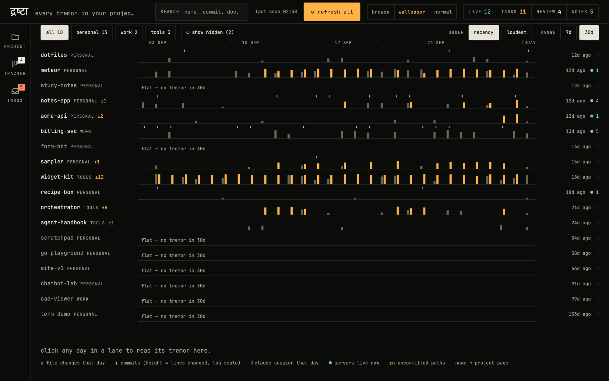
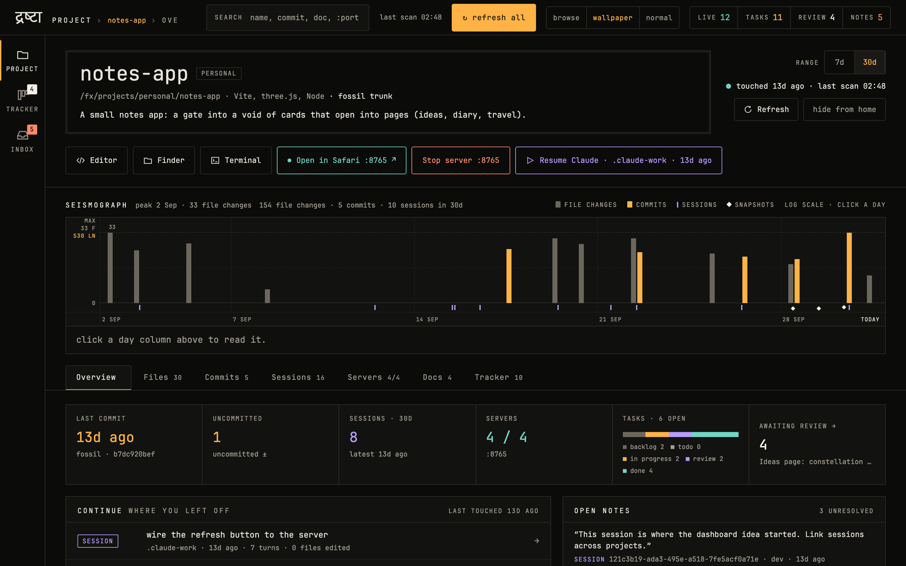
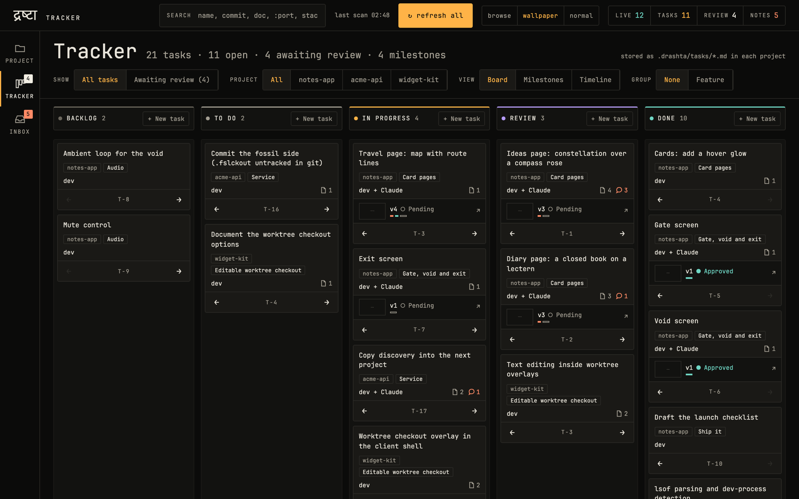
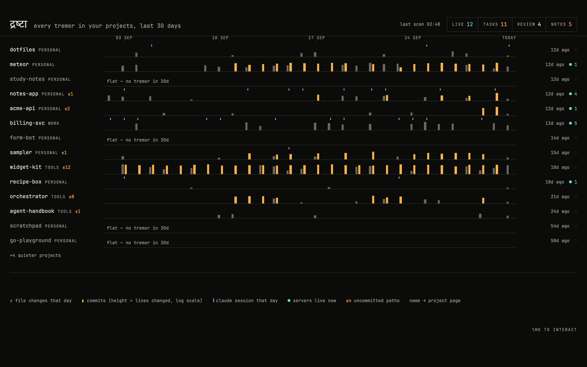

<div align="center">

# द्रष्टा drashta

**A local command center for everything you build.**
A project dashboard you open in any browser, and the same page doubles as a live desktop wallpaper.

[](https://github.com/Prath2000/drashta/actions/workflows/ci.yml)
[](LICENSE)




</div>

drashta (Sanskrit for "the one who sees") is a project and production dashboard that runs on your own machine. Point it at the folder where your projects live and it shows what is moving, what is stuck and what is running, with no accounts, no cloud and no setup per project.

It is a single Go binary with the web app built in. Start it, open a browser tab, done.

## What you get

- **A seismograph of your work.** One lane per project for the last 7 or 30 days: file changes, commits, coding-assistant sessions, live servers and uncommitted work. Quiet projects fade out, busy ones stand out.
- **Project pages.** Open any project for its activity, files, commits, docs, running servers and sessions, with one-click Editor, Finder, Terminal and Open-in-browser buttons.
- **A built-in tracker.** Kanban board, milestones and timeline across projects. Tasks and notes are plain Markdown in `<project>/.drashta/`, so they diff and version with your code.
- **An inbox** for things waiting on your review.
- **Search** across projects, commits, docs and Claude Code sessions.
- **File viewers** for PDF, DWG drawings and 3D models, with a full-window mode.
- **Git and Fossil** history out of the box. Optional GitHub data through the `gh` CLI.
- **Local and private.** It binds to loopback only, and nothing leaves your machine.

<table>
  <tr>
    <td></td>
    <td></td>
  </tr>
  <tr>
    <td align="center"><b>Project page</b></td>
    <td align="center"><b>Tracker</b></td>
  </tr>
</table>

## Browser page and wallpaper

drashta is a normal web page, so you can use it in a browser tab, as a wallpaper, or both at once. Three display modes, switched from the top bar:

| Mode | What it does |
| --- | --- |
| **normal** | The regular dashboard in a browser tab. |
| **wallpaper** | A quiet, read-only readout of your activity. Made to sit behind your windows. |
| **browse** | The same view on your desktop, but clickable, so you can jump straight into a project. |

<p align="center"></p>

Both tools below are optional; the dashboard works fully without them.

- **macOS: [Plash](https://sindresorhus.com/plash)** turns any web page into your desktop background. drashta ships a script and an optional [Karabiner-Elements](https://karabiner-elements.pqrs.org/) rule to switch modes with a key press. See [`contrib/desktop/`](contrib/desktop/README.md).
- **Windows (new, early): [Lively Wallpaper](https://github.com/rocksdanister/lively)** can use a web page URL as your wallpaper. See [`contrib/desktop/lively/README.md`](contrib/desktop/lively/README.md). The mode buttons and the Plash script are macOS-only there.

## Quick start

You need Go (version in `go.mod`) and Node.js (current LTS or newer; the web app is built once). Windows support is new and early, so expect rough edges.

macOS and Linux:

```bash
git clone https://github.com/Prath2000/drashta.git
cd drashta
npm --prefix web ci
npm --prefix web run build
go build -o drashta ./cmd/drashta
./drashta
```

Windows (PowerShell, same steps; the binary is `drashta.exe`):

```powershell
git clone https://github.com/Prath2000/drashta.git
cd drashta
npm --prefix web ci
npm --prefix web run build
go build -o drashta.exe ./cmd/drashta
.\drashta.exe
```

Open <http://127.0.0.1:4455>.

- `./drashta -port 4467` picks another port.
- `./drashta -version` prints the version. `./drashta -reindex` rebuilds the cache and exits.
- The `make` targets are macOS-only. On Windows use the plain commands above (and see the Lively guide to start it at login).
- `make install` copies the binary to `/opt/homebrew/bin`, and `make service` installs a launchd agent so drashta starts at login. Both change your machine, so read the `Makefile` first.

## Make it yours

Nothing assumes a folder layout. On first start drashta finds your projects folder and writes `~/.drashta/config.toml`. Edit it and restart.

```toml
projects_dir = "~/code"          # where your projects live (default ~/projects)
roots = ["work", "personal"]     # group folders inside projects_dir; each folder in a group is a project
hidden = ["old-experiments"]     # hide from the UI (folder name, group/folder, or project id)
editor = "code -g {path}:{line}" # command behind "open in editor"
terminal = "Terminal"            # app behind "open in terminal"
gh_enabled = true                # allow calls to the gh CLI for GitHub data
```

<details>
<summary>All settings</summary>

- `projects_dir`: the folder that holds your projects.
- `roots`: group folders inside `projects_dir`. When unset, they are discovered from the disk.
- `hidden`: project folders to hide. They are still found, so you can show them again.
- `skip`: extra folder names the file-tree walk will not enter.
- `editor`: the command that opens a file. `{path}` and `{line}` are filled in. Only `config.toml` can set it, never the API.
- `terminal`: the terminal app used to open a project.
- `claude_profiles`: Claude Code profile folders that hold `projects/<folder>/*.jsonl` sessions. Found automatically when unset.
- `gh_enabled`: allow calls to the `gh` CLI. Without `gh`, GitHub panels stay empty.
- `desktop_script`: optional script behind the mode buttons. Empty means off. It must be inside `projects_dir`.
- `chitralipi`: path of the DWG reader program.

Set `DRASHTA_HOME` to use another data folder instead of `~/.drashta` (useful for trying it out or for tests).

</details>

## Requirements

- **macOS and Windows** are supported. Windows support is new and early. Linux builds but is untested.
- Running dev servers are found with `lsof` on macOS (it ships with macOS). Windows needs nothing extra: it uses the built-in `netstat`.
- Optional:
  - `git` for history and activity.
  - `gh` (GitHub CLI) for GitHub data.
  - `chitralipi`, a DWG reader. Without it, a DWG file offers "Open in default app" instead of a preview.

## Your data

- `~/.drashta/` holds the SQLite index (`index.db`), `config.toml` and logs.
- `<project>/.drashta/*.md` holds per-project tasks and notes. These files are the source of truth.
- The index is a cache plus a history log. `-reindex` rebuilds most of it, but the activity and server-run history cannot be rebuilt, so keep them if you want that history.

## Privacy and security

- Everything stays on your machine. The one exception is the optional `gh` CLI, which talks to GitHub the way it normally does. Set `gh_enabled = false` to avoid that.
- drashta reads Claude Code session transcripts (`~/.claude*/projects/*/*.jsonl`) for the sessions view. Known secret patterns are redacted before text reaches the index, search or the API. Redaction is pattern based, so treat `~/.drashta/index.db` as sensitive.
- The server binds to loopback and checks `Host`, `Origin` and `Sec-Fetch-Site` on requests. Every mutating call needs a per-page token. This keeps other web pages in your browser from talking to it.
- Anything that runs a command goes through a no-shell runner with path checks.
- It is a single-user tool with no login. Do not expose the port to a network (no reverse proxy, no port forwarding).

To report a vulnerability, see [`SECURITY.md`](SECURITY.md).

## Limitations

- Single user, single machine. There is no remote access.
- The Claude Code `.jsonl` format is not a public contract. Unknown record types are counted and skipped, but a format change can hide some data.

## Development

```bash
gofmt -l .                                   # must print nothing
go vet ./... && go test -race -count=1 ./... # takes a couple of minutes
cd web && npm run typecheck && npx vitest run && npm run e2e
```

- `npm ci` deletes `web/node_modules` and reinstalls it. Run it on purpose.
- Try it without touching your real data: `DRASHTA_HOME=$(mktemp -d) ./drashta -port 4467`. Check the port is free first with `lsof -nP -iTCP:4467 -sTCP:LISTEN`.
- `npm --prefix web run dev` starts the Vite dev server (run drashta with `-dev` beside it). `npm --prefix web run dev:mock` runs the UI on mock data, which is how the screenshots above were made.
- After any UI change, check the layout in a headless browser at 1440x900 and 1000x665. Unit tests cannot see layout.

Where things live:

- `cmd/drashta`: entry point and command line.
- `internal/`: Go packages. Each has a `doc.go` that lists its API.
- `web/`: the React app, built into `web/build/client` and embedded in the binary.
- `docs/`: architecture, decisions and specs. Start with [`docs/README.md`](docs/README.md).
- `contrib/desktop/`: the optional wallpaper-mode scripts.

## Contributing

Issues and pull requests are welcome. See [`CONTRIBUTING.md`](CONTRIBUTING.md).

## License

MIT. See [`LICENSE`](LICENSE).
